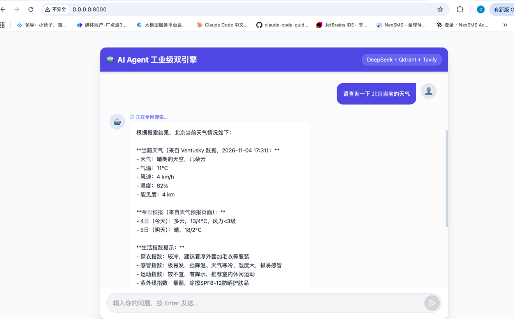
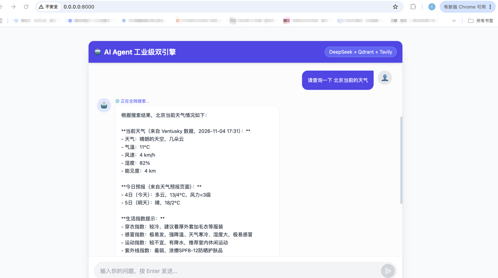
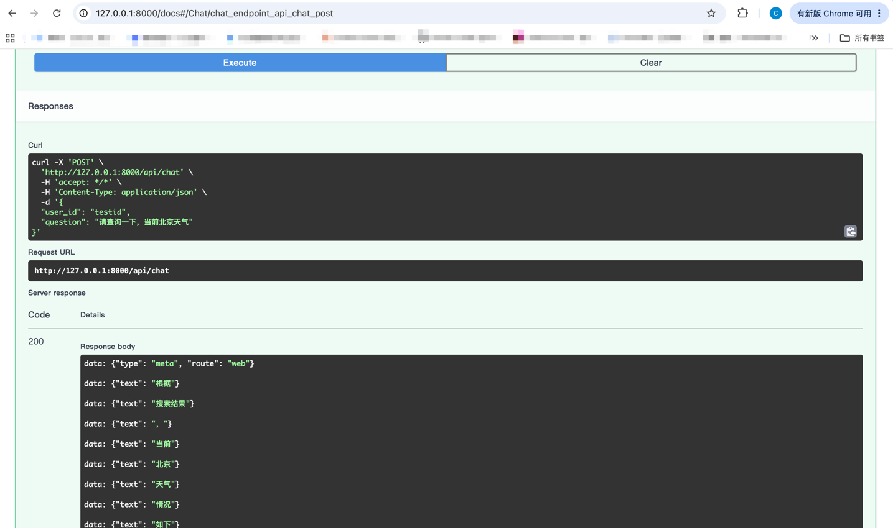

# 🤖 AI-Agent-Project: 工业级双引擎知识助手

基于 FastAPI + DeepSeek + Qdrant + MySQL 构建的智能 Agent，支持私有知识库 RAG 检索与全网实时搜索。

## 📸 界面预览





## 🌟 核心特性

- **🧠 意图路由 Agent**：基于大模型自决策，精准识别用户意图，自动路由至“本地知识库”或“全网搜索”。
- **📚 双引擎驱动**：
  - 私有知识库：Qdrant 向量数据库 + `bge-small-zh` 语义检索。
  - 全网搜索：Tavily Search API 实时搜索。
- **💾 记忆分离架构**：MySQL（结构化对话历史） + Qdrant（非结构化语义知识）。
- **⚡ 流式响应**：基于 FastAPI SSE 实现大模型输出实时推送。
- **🐳 一键部署**：Docker Compose 统一编排 MySQL 与 Qdrant 基建。
- **💻 前端全栈闭环**：内置高颜值单文件聊天 UI，原生解析 SSE 流，支持打字机效果与 Agent 路由状态提示。
## 🏗️ 项目架构

项目采用标准的分层架构，目录结构如下：

```text
├── app/
│   ├── routers/       # 路由层：处理 HTTP 请求与 SSE 流
│   ├── services/      # 服务层：Agent 决策、记忆读写
│   ├── tools/         # 工具层：封装 Qdrant 与 Tavily
│   ├── config.py      # 全局配置
│   ├── database.py    # 数据库连接池
│   └── models.py      # ORM 模型
├── index.html         # 前端聊天 UI（Vue3 + Tailwind CDN）
├── main.py            # 启动入口
├── docker-compose.yml # 基建编排
└── seed_rag.py        # 知识库初始化脚本

```
## 🚀 快速启动

### 1. 环境准备：Docker Desktop, Python 3.10+
确保你的电脑已安装上述环境。

### 2. 配置文件
在 `.env` 中填入 `LLM_API_KEY` 和 `TAVILY_API_KEY`。
```env
LLM_API_KEY=sk-你的DeepSeek密钥
LLM_BASE_URL=https://api.deepseek.com
TAVILY_API_KEY=tvly-你的Tavily密钥
```

### 3. 启动数据库
使用 Docker Compose 一键拉起服务：
```bash
docker compose up -d
```


### 4.  安装依赖
安装项目所需的 Python 依赖包：
```bash
pip install -r requirements.txt
```


### 5.  初始化私有知识库
运行脚本，将测试数据向量化并存入 Qdrant 向量数据库：
```bash
python seed_rag.py
```


### 6.  启动服务
启动 FastAPI 后端服务：
```bash
python main.py
```
启动成功后，在浏览器访问 `http://127.0.0.1:8000/` 即可体验完整的聊天 UI 界面。
（也可访问 `http://127.0.0.1:8000/docs` 查看底层的 Swagger API 文档）。


## 🧠 核心技术实现

- **Agent 意图路由**：利用大模型的 JSON Output 能力，对用户问题进行前置分类（RAG 检索、全网搜索、闲聊），有效降低 Token 消耗与系统延迟。

- **长短期记忆分离**：利用 MySQL 存储结构化对话历史（短期），利用 Qdrant 存储非结构化语义片段（长期）。

- **流式响应 (SSE)**：基于 FastAPI `StreamingResponse` 实现打字机效果，优化前端交互体验。

- **工程化部署**：基于 Docker Compose 统一编排 MySQL 与 Qdrant，解决本地环境一致性问题。


## 📝 开发踩坑记录

- **Docker 环境 MySQL 字符集乱码**：在 Mac 环境下通过 Docker 运行 MySQL 9.x，发现中文写入变成问号。最终通过在 docker-compose.yml 中配置 LANG=C.UTF-8、LC_ALL=C.UTF-8 以及启动参数 --character-set-server=utf8mb4 彻底解决。
- **Swagger UI 无法完整展示 SSE**: Swagger 对长连接流式响应支持不佳，后续通过 curl 命令或前端项目进行完整联调。


